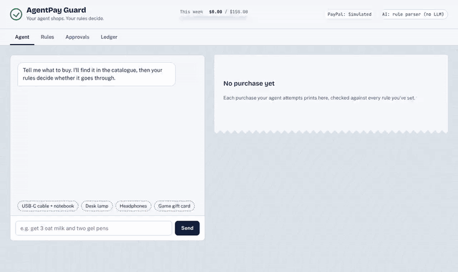
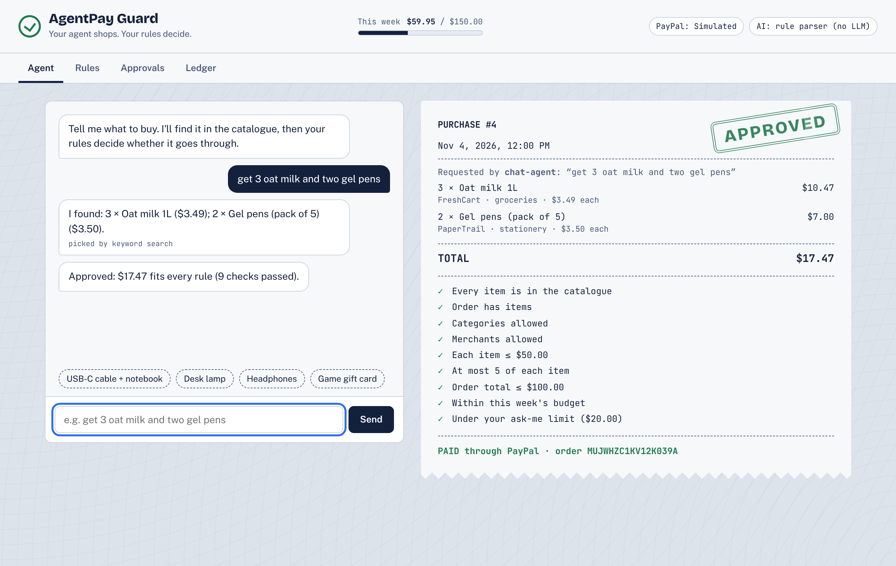
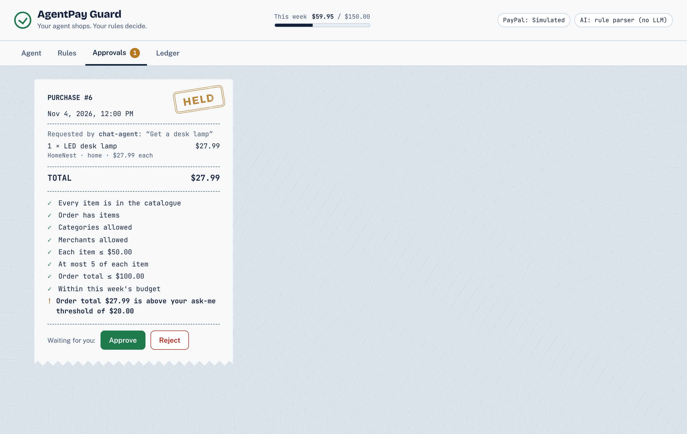
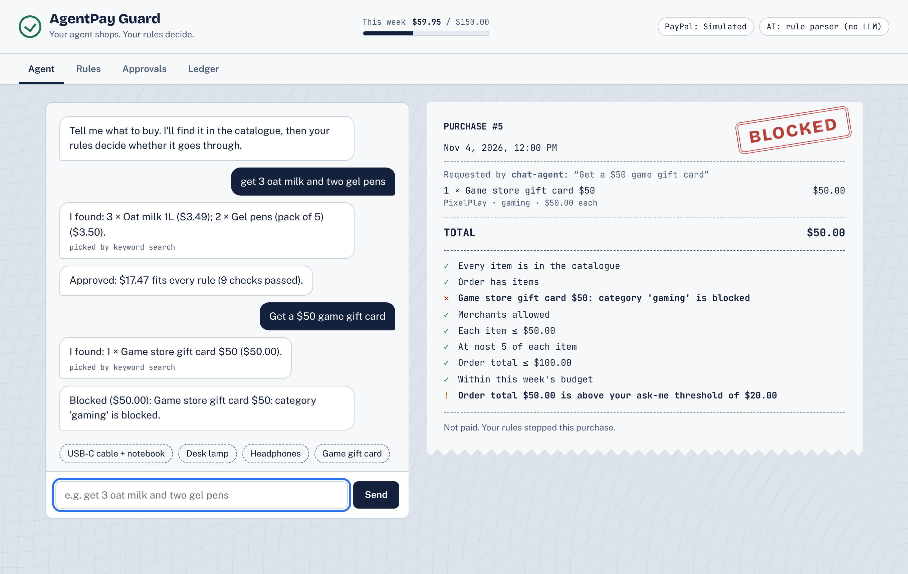
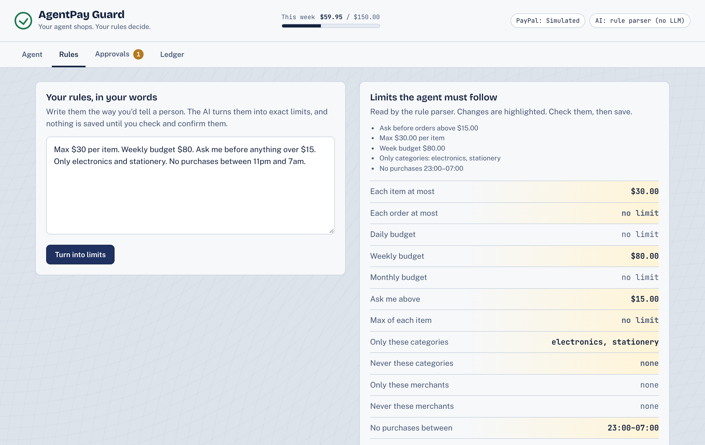
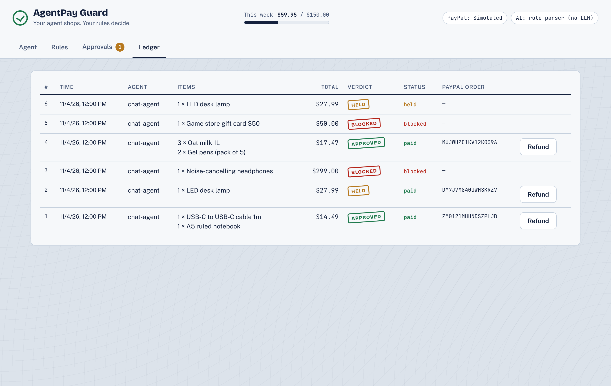
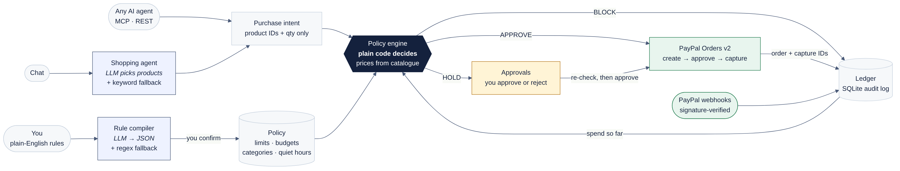

# AgentPay Guard

**AI agents can shop for you. AgentPay Guard makes sure they only spend what you allow.**

You write spending rules in plain English, and an LLM turns them into exact limits. Your shopping agent (or any AI agent, over MCP or REST) proposes purchases. **Plain, deterministic code, not the AI**, approves, holds or blocks every one. Approved purchases are paid through **PayPal Orders v2**, and every decision lands in an audit log with its reasons and PayPal order ID.




▶️ **Demo video (under 3 min):** _link added at submission_ · Built for the [PayPal AI Hackathon 2026](https://paypalaihackathon.devpost.com/)

| Approved and paid | Held for you | Blocked by your rules |
|---|---|---|
|  |  |  |
| **Plain English → exact limits** | **Ledger and refunds** | |
|  |  | |

---

## The problem

Agentic commerce is arriving: assistants that reorder groceries, buy parts, book things. But handing an LLM your wallet with no limits is a bad idea. LLMs misread requests, hallucinate products and prices, and can be prompt-injected. People need **guardrails they can state in their own words** and **a decision-maker that can't be talked out of them**.

## How it works



<details><summary>Mermaid source</summary>

See [`docs/architecture.mmd`](docs/architecture.mmd).

</details>

1. **Rules → policy.** "Max $50 per item, weekly budget $150, ask me above $20, no gaming, no purchases 11pm–7am" becomes a validated policy. The LLM writes it, Pydantic checks it, a regex parser covers for the LLM if it's missing or wrong, and **nothing is saved until you confirm it**.
2. **Agent → intent.** The shopping agent (LLM, with keyword search as fallback) turns "get 3 oat milk and two gel pens" into product IDs and quantities. Unknown IDs are dropped. **The agent can't set prices.**
3. **Policy engine decides.** Pure Python checks known products, categories, merchants, per-item and per-order caps, quantity, day/week/month budgets against the ledger, quiet hours and your ask-me threshold. Any BLOCK means BLOCK, otherwise any HOLD means HOLD, otherwise APPROVE. Every rule checked is listed on the receipt.
4. **PayPal pays.** Approved purchases become PayPal Orders v2 orders (create → buyer approval → capture), with idempotency keys and amount checks. Held purchases wait for you and are **re-checked against your current spend** when you approve, so two held items can't sneak past a budget together.
5. **Everything is logged.** The SQLite ledger keeps the status lifecycle (`held → approved → paid → refunded`), with invalid transitions rejected. Signature-verified PayPal webhooks reconcile captures and refunds even if the browser closes mid-checkout.

**Safety principle:** the LLM proposes and the code decides. The AI explanation shown to you is display-only, and it's thrown away if it changes any number.

## Run it in 2 minutes

```bash
git clone https://github.com/RayonBiswas/agentpay-guard && cd agentpay-guard
python -m venv .venv && source .venv/bin/activate      # Windows: .venv\Scripts\activate
pip install -r requirements.txt
uvicorn app.main:app --reload                          # open http://localhost:8000
```

No keys needed: it starts in **simulation mode** (realistic PayPal order IDs and states) with the deterministic parsers. Try the four suggestion chips on the Agent tab.

**Real PayPal sandbox.** Create a free app at [developer.paypal.com](https://developer.paypal.com/), then:

```bash
cp .env.example .env
# PAYPAL_MODE=sandbox, PAYPAL_CLIENT_ID=..., PAYPAL_CLIENT_SECRET=...
```

The UI then shows real PayPal buttons and you pay with a sandbox buyer account. For webhooks, add `PAYPAL_WEBHOOK_ID` and point your sandbox app's webhook at `/api/paypal/webhook`.

**Use an LLM** (any OpenAI-compatible endpoint, local by default):

```bash
ollama pull llama3.2:3b
# .env: LLM_BASE_URL=http://localhost:11434/v1  LLM_MODEL=llama3.2:3b
```

**Settings** (`.env`): `AUTOPAY=auto|on|off` (on means approved purchases are paid immediately, simulating a saved PayPal wallet; off means you click Pay) · `AGENT_API_KEY` (required header for external agents) · `POLICY_TIMEZONE`.

**Deploy:** `render.yaml` (Render blueprint) and a `Dockerfile` are included.

## Let other AI agents shop through it (MCP)

```bash
pip install -r requirements-mcp.txt
python -m mcp_server.agentpay_mcp        # stdio MCP server
```

Claude Desktop / Cursor config:

```json
{ "mcpServers": { "agentpay-guard": {
    "command": "python", "args": ["-m", "mcp_server.agentpay_mcp"],
    "cwd": "/path/to/agentpay-guard",
    "env": { "AGENTPAY_URL": "http://localhost:8000" } } } }
```

Tools: `search_catalog`, `request_purchase`, `check_budget`, `purchase_status`. Blocked results tell the agent not to retry or split the purchase. Prefer REST? `POST /api/intents` with `{"items":[{"product_id":"esp32-board","quantity":2}],"agent":"my-bot"}`. A Postman collection is in [`postman/`](postman/).

## Tests

```bash
pytest -q          # 110 passed
```

The tests cover every policy rule and edge (exact limits, merged duplicate lines, quiet hours across midnight, budget windows in the user's timezone), the LLM paths with a fake model (invalid JSON, hallucinated IDs, attempts to inject prices), the PayPal sandbox client against mocked HTTP (OAuth caching, idempotency headers, error wrapping), the simulator lifecycle, the full API story, webhooks (signature, replay, amount and order mismatch), and the MCP tools end-to-end against the real app. The UI was driven in Chromium with Playwright, and the screenshots above come from those runs.

## AI used, and how

| Where | What the AI does | What it's **not** allowed to do |
|---|---|---|
| Rule compiler | Turns plain-English rules into policy JSON (dollars → cents, synonyms → categories) | Save anything without your confirmation; invent rules |
| Shopping agent | Picks catalogue products and quantities for a chat request | Set prices, use unknown products, decide if the purchase is allowed |
| Explanations | Rewrites a decision into one friendly sentence | Change the outcome or any number (rewrites that drop the total are discarded) |

Model: any OpenAI-compatible endpoint. Development default is **Llama 3.2 3B via Ollama** running locally; hosted endpoints (e.g. Groq, OpenAI) work by changing three env vars. Every AI step has a deterministic fallback, so the app works with no model at all.

## PayPal tech used

- **Orders v2 REST API:** OAuth client-credentials, create order with itemised breakdown, capture, refund, `PayPal-Request-Id` idempotency
- **PayPal JS SDK buttons** for buyer approval (sandbox mode)
- **Webhooks** (`PAYMENT.CAPTURE.COMPLETED`, `PAYMENT.CAPTURE.REFUNDED`) verified with `verify-webhook-signature`
- Sandbox throughout; the simulator mirrors Orders v2 states for keyless demos

## Roadmap

- PayPal **Vault** (payment-method tokens) so auto-approved purchases are charged with no popup in sandbox and live, which makes truly autonomous agent payments possible
- Real merchant catalogues (PayPal Commerce / product feeds) instead of the mock catalogue
- Per-agent policies and spending keys (e.g. a grocery agent with its own budget)
- Weekly spending summary and anomaly alerts
- Drop-in payment layer for an IoT smart-pantry reorder system

## Project layout

```
app/
  policy_engine.py   deterministic APPROVE / HOLD / BLOCK (the only money decision-maker)
  rule_compiler.py   plain English → Policy (LLM + regex fallback)
  agent.py           chat → PurchaseIntent (LLM + keyword fallback), explanations
  paypal_client.py   Orders v2 sandbox client + simulator, webhook verification
  ledger.py          SQLite audit log, status lifecycle, budget windows
  service.py         wires it all together
  main.py            FastAPI routes + UI
  static/            single-page UI (no build step)
mcp_server/          MCP server for external agents
tests/               110 tests
docs/                plan, architecture, media
```

## Built with

Python · FastAPI · Pydantic · SQLite · httpx · PayPal Orders v2 + JS SDK · Ollama (Llama 3.2) · MCP Python SDK · Playwright · vanilla JS/CSS. Fonts: Bricolage Grotesque, Public Sans, JetBrains Mono (OFL). Developed with help from an AI coding assistant (Claude); the design, testing and decisions are documented in this repo. All merchants and products in the catalogue are fictional.

## License

[MIT](LICENSE) © 2026 Rayon Biswas
